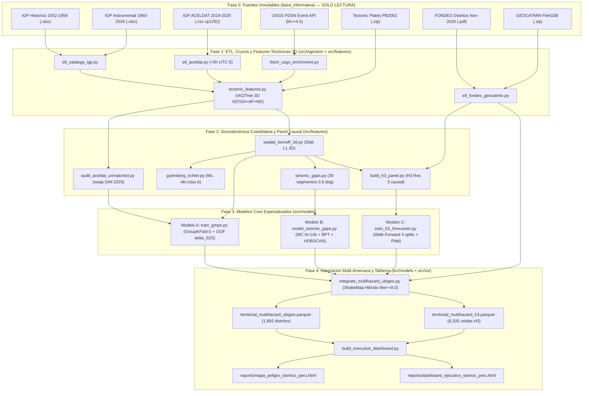

# ARCHITECTURE.md — Arquitectura End-to-End del Sistema Sismotectónico y Multi-Amenaza Territorial del Perú

Este documento describe la arquitectura completa de ingeniería de datos, modelado geofísico/ML y contrato extensible multi-amenaza implementada en el repositorio (`Fase 0 → Fase 4`).

---

## 1. Diagrama de Flujo de Datos End-to-End (`Fase 0 → Fase 4`)



---

## 2. Inventario de Capas `.parquet` y Modelos Serializados

| Capa | Archivo | Filas × Cols | Llave Primaria | Descripción |
| :--- | :--- | ---: | :--- | :--- |
| `data/processed/` | `catalog_igp_instrumental.parquet` | 25,878 × 34 | `event_id` | Catálogo IGP 1960–2026 (`datetime64[us, UTC]`), USGS, slab 3D, 4 regímenes, H3 |
| `data/processed/` | `catalog_igp_historico.parquet` | 1,098 × 27 | `event_id` | Catálogo IGP 1552–1959 con $M_w$ homogeneizada (Scordilis 2006), slab 3D, H3 |
| `data/processed/` | `aceldat_merged.parquet` | 17,794 × 67 | `(event_id, cod_estacion)` | 956 eventos únicos, 277 estaciones, distancias 3D, PGA 3 componentes, regímenes |
| `data/processed/` | `aceldat_station_site_factors.parquet` | 277 × 16 | `cod_estacion` | Términos de sitio $\delta S_{2S}$ regularizados y amplificación rel. a roca `MSOL` |
| `data/processed/` | `coastal_seismic_gaps.parquet` | 30 × 31 | `segment_id` | Balance determinístico de momento por segmento costero $0.5^\circ$ |
| `data/processed/` | `seismic_gaps_probabilistic.parquet` | 35 × 27 | `entity_id` | 30 segmentos + 5 macro-bloques: MC P10/P50/P90, BPT 30/50a, HDBSCAN |
| `data/processed/` | `h3_spatiotemporal_panel.parquet` | 2,650,215 × 53 | `(h3_res5, cut_date_utc)` | Panel mensual estrictamente causal `2000–2026` (sin censura derecha en targets) |
| `data/processed/` | `h3_forecast_latest.parquet` | 8,205 × 17 | `h3_res5` | Pronóstico probabilístico calibrado vigente (`2026-11-01`) |
| `data/processed/` | `distritos_maestro_ubigeo.parquet` | 1,893 × 21 | `ubigeo` | Base distrital FONDES/SIGRID + agregados GEOCATMIN |
| `data/processed/` | **`territorial_multihazard_ubigeo.parquet`** | **1,893 × 74** | **`ubigeo`** | **Tabla maestra distrital integrada (ShakeMaps híbridos + BPT + H3 + contrato `ext_*`)** |
| `data/processed/` | **`territorial_multihazard_h3.parquet`** | **8,205 × 30** | **`h3_res5`** | **Tabla maestra hexagonal H3 res 5 integrada + contrato `ext_*`** |
| `models/` | `gmpe_lgbm.joblib` | — | — | Bundle Modelo A (`model_no_site`, `model_with_site`, lookup $\delta S_{2S}$) |
| `models/` | `h3_forecaster_lgbm.joblib` | — | — | Bundle Modelo C (LightGBM + calibradores Platt `90d`, `365d`, `M>=5.0`) |

---

## 3. Contrato de Llaves Interoperables

Todas las tablas analíticas se vinculan mediante 3 llaves inmutables:
1. **`event_id` (`str`):** `IGP_INST_00001..25878` / `IGP_HIST_00001..01098`. Garantiza trazabilidad catálogo–acelerometría–USGS y validación `GroupKFold` sin fuga en GMPE.
2. **`ubigeo` (`str`, exactamente 6 dígitos con `zfill(6)`):** Llave oficial INEI/FONDES/SIGRID/GEOCATMIN/ACELDAT que habilita integración directa con censos, presupuesto público y gestión de emergencias.
3. **`h3_res5` (`str`, WGS84 `EPSG:4326`):** Índice espacial jerárquico Uber H3 (~252 km² en res 5, con equivalentes `h3_res6`/`h3_res7` en capas puntuales) para análisis continuo independiente de límites administrativos.

---

## 4. Guía de Extensión Futura Multi-Amenaza (Sin Romper Esquemas)

Tanto `territorial_multihazard_ubigeo.parquet` como `territorial_multihazard_h3.parquet` ya incluyen las columnas reservadas `ext_*` (`float64`, `NaN` por defecto) listas para acoplar nuevos módulos en futuras fases:

| Módulo Futuro | Fuente Recomendada | Llave de Acoplamiento | Columna Destino | Pipeline Sugerido (`src/`) |
| :--- | :--- | :--- | :--- | :--- |
| **Lluvias Extremas / Huaicos / Inundaciones** | SENAMHI (PISCO/grillas precipitación), ANA (fajas marginales), INGEMMET GEOCATMIN | `h3_res5` + `ubigeo` | `ext_hydromet_flood_idx` (0–100) | `src/ingestion/fetch_senamhi_ana.py` → combinar anomalía de precipitación P95 con `n_peligros_flujo` y `n_zonas_criticas_activas` existentes |
| **Incendios Forestales** | NASA FIRMS (VIIRS/MODIS hotspots diarios) + SERFOR | `h3_res5` (`latlng_to_cell(lat, lon, 5)`) + `ubigeo` | `ext_wildfire_firms_idx` (0–100) | `src/ingestion/fetch_nasa_firms.py` → agregar FRP (*Fire Radiative Power*) estacional y densidad por celda H3 |
| **Vulnerabilidad Socioeconómica y Exposición** | INEI (Censo 2017 / proyecciones población, material predominante de vivienda adobe/quincha, pobreza monetaria, establecimientos de salud MINSA) | `ubigeo` (6 díg.) | `ext_social_vuln_idx` (0–100) | `src/ingestion/etl_inei_vuln.py` → cruzar por `ubigeo` exacto; ponderar porcentaje de viviendas de adobe/albañilería no confinada con `pga_escenario_max_gal` |
| **Índice Compuesto Multi-Riesgo Nacional** | Integración de peligro sísmico + hidrometeorológico + incendios × vulnerabilidad | `ubigeo` y `h3_res5` | `ext_composite_multirisk_idx` (0–100) | `src/models/compute_multirisk_score.py` → Riesgo = $\text{Peligro}_{\text{multi}} \times \text{Exposición} \times \text{Vulnerabilidad}$ |

---

## 5. Orden Reproducible de Ejecución Completa

```bash
# Fase 0: Auditoria y extraccion limpia a data/raw/
python src/ingestion/audit_base_informativa.py

# Fase 1: ETL, cruces y features sismotectonicas 3D
python src/ingestion/etl_catalogs_igp.py
python src/ingestion/etl_aceldat.py
python src/ingestion/fetch_usgs_enrichment.py
python src/ingestion/etl_fondes_geocatmin.py
python src/features/tectonic_features.py

# Fase 2: EDA cuantitativo, slab 3D, lagunas y panel H3 causal
python src/features/audit_aceldat_unmatched.py
python src/features/wadati_benioff_3d.py
python src/features/gutenberg_richter.py
python src/features/seismic_gaps.py
python src/features/build_h3_panel.py

# Fase 3: Modelado core especializado (A, B, C)
python src/models/train_gmpe.py
python src/models/model_seismic_gaps.py
python src/models/train_h3_forecaster.py

# Fase 4: Integracion territorial multi-amenaza y tableros ejecutivos
python src/models/integrate_multihazard_ubigeo.py
python src/viz/build_executive_dashboard.py
```
